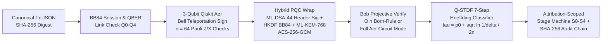
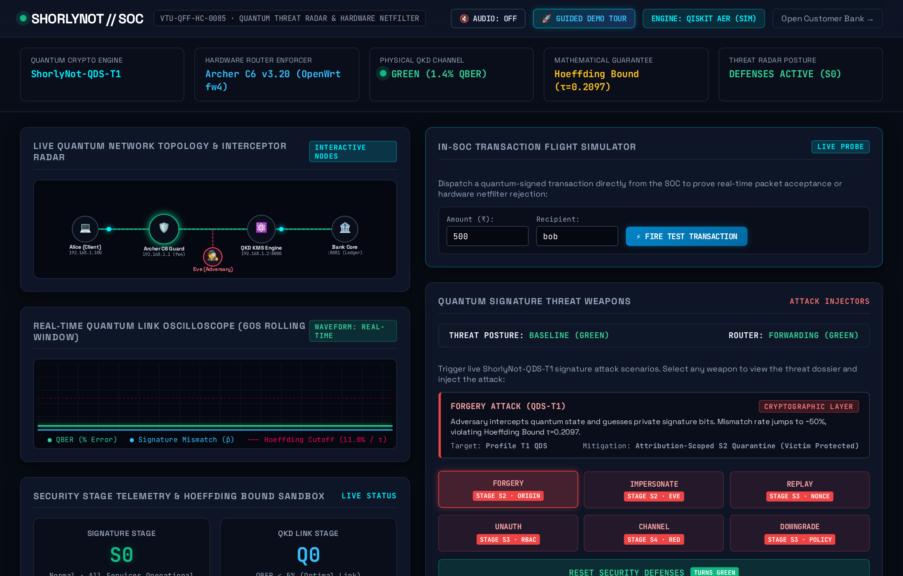
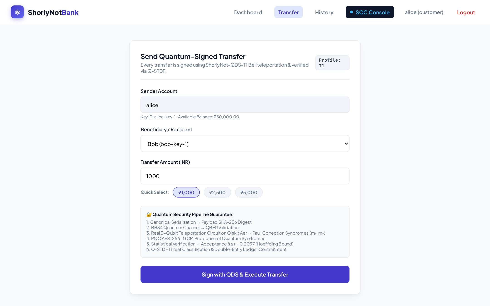

<div align="center">

# ShorlyNot — Momosapiens

**Teleportation-Assisted Quantum Digital Signatures (`ShorlyNot-QDS-T1`) & Statistical Threat Detection (`Q-STDF`)**

**VTU-QFF-HC-0085** &nbsp;|&nbsp; Tier: **Online**


</div>

---

<div align="center">

| Field | Details |
| :--- | :--- |
| **Team** | Momosapiens |
| **Team ID** | `VTU-QFF-HC-0085` |
| **Tier** | Online |
| **Track / Category** | Online · Quantum Cryptography, Security & Simulation |
| **Repository** | [vtu-qiskit-fall-fest-2026/vtu-hc-momosapiens](https://github.com/vtu-qiskit-fall-fest-2026/vtu-hc-momosapiens) |
| **Organisation** | [vtu-qiskit-fall-fest-2026](https://github.com/vtu-qiskit-fall-fest-2026) |
| **Event** | VTU-QFF Hackathon — VTU-Qiskit Fall Fest 2026 |

</div>

---

## 📌 Table of Contents

- [Team Members](#-team-members-github-ids)
- [Problem Statement](#-problem-statement)
- [Proposed Solution](#-proposed-solution)
- [Approach & Architecture](#-approach--architecture)
- [Results & Classical Baseline Comparison](#-results--classical-baseline-comparison)
- [Visual Walkthrough & Plots](#-visual-walkthrough--plots)
- [Tech Stack](#-tech-stack)
- [Project Structure](#-project-structure)
- [How to Run (Under 5 Minutes)](#-how-to-run-under-5-minutes)
- [How to Push Code](#-how-to-push-code)
- [Deep-Dive Technical Documentation](#-deep-dive-technical-documentation)
- [Submission Checklist](#-submission-checklist)
- [License](#-license)

---

## 👥 Team Members (GitHub IDs)

| # | Name | GitHub Username | Role |
| :-- | :--- | :--- | :--- |
| 1 | Santhnu | [@Sansyuh06](https://github.com/Sansyuh06) | Team Lead · Quantum Protocol, PQC & Engine |
| 2 | Shivani | [@inavihs124](https://github.com/inavihs124) | Developer · Threat Detection, Banking Gateway & SOC |

---

## ❓ Problem Statement

**Problem:** High-value financial transactions rely on classical public-key digital signatures (RSA / ECDSA) that are broken in polynomial time by Shor's algorithm on fault-tolerant quantum computers, while conventional anomaly detectors rely on opaque ML classifiers vulnerable to distribution shift and adversarial evasion. Worse, naive security gateways that freeze an account whenever failed signatures claim its identity allow an attacker to weaponize bad signatures into a denial-of-service lockout against honest users.

**Why it matters:** Payment gateways and security operations centers need a cryptographically grounded, quantum-native authentication and threat-detection pipeline whose false-reject and forgery bounds are provable from physics and concentration inequalities—without locking out innocent victims during spoofing attacks.

**Track / Category:** `Online · Track 3 — Quantum Applications, Cryptography & Simulation`

---

## 💡 Proposed Solution

**Solution:** **ShorlyNot** combines **teleportation-assisted 2-party quantum message authentication (`ShorlyNot-QDS-T1`)** simulated via real 3-qubit dynamic Qiskit `AerSimulator` circuits, **NIST FIPS 203/204 Post-Quantum Cryptography (`ML-KEM-768` + `ML-DSA-44`)**, and a **training-free Hoeffding statistical threat classifier (`Q-STDF`)** integrated into a live banking gateway, Dark SOC console, and OpenWrt `fw4`/`nftables` router guard.

**Key idea:** Encode transaction digest bits into random Pauli $\{Z, X\}$ eigenstates teleported across shared $|\Phi^+\rangle$ Bell pairs so any unentangled forger collapses projective check measurements at $\hat{p} \to 0.50 \gg \tau = 0.2097$ ($P_{\text{forge}} = 9.40 \times 10^{-7}$ at $n = 64$), while `ML-DSA-44` header signatures attribute impersonation to the real signer so **forged traffic naming Alice never locks Alice out**.

**Scope & Scientific Honesty:** In our two-party Profile T1 implementation, the verifier compares syndromes against its entangled session store (symmetric tamper-evidence between payer and bank gateway, distinct from 3-party arbitrated non-repudiation). Every claim, assumption, and simulator boundary is documented explicitly in [`docs/CLAIMS_VS_EVIDENCE.md`](docs/CLAIMS_VS_EVIDENCE.md) and [`docs/KNOWN_LIMITATIONS.md`](docs/KNOWN_LIMITATIONS.md).

---

## 🧩 Approach & Architecture



1. **Input & Canonical Digest:** Canonical transaction payload (`from_user`, `to_user`, `amount`, `currency`, `tx_id`) hashed via SHA-256 into deterministic bit positions.
2. **Quantum Sign Core (`QiskitAerEngine`):** For each of $n = 64$ check positions, prepares $|\psi(b_i, \beta_i)\rangle \in \{|0\rangle, |1\rangle, |+\rangle, |-\rangle\}$, entangles a 3-qubit Bell circuit (`H`, `CX`), measures $(q_0, q_1)$ to obtain Bell syndrome $(m_{1,i}, m_{2,i})$, and exercises dynamic Qiskit `if_test` Pauli recovery.
3. **Hybrid PQC Protection:** Signs header metadata with **`ML-DSA-44`** (FIPS 204), derives a hybrid wrap key via `HKDF-SHA256(BB84_key || ML-KEM-768_secret)` (FIPS 203), encrypts syndromes under **`AES-256-GCM`**, and redacts plaintext syndromes in transit.
4. **Verification & Non-ML Detection (`Q-STDF`):** Evaluates check mismatches via sub-millisecond $O(n)$ Born-rule statevector projection (or selectable `mode="circuit"` full `AerSimulator` execution) and classifies anomalies deterministically against $\tau = p_0 + \sqrt{\ln(1/\delta)/(2n)}$ across a strict 7-step ladder (`UNAUTH_VERIFY`, `IMPERSONATION`, `REPLAY`, `PARAM_TAMPER`, `CHANNEL`, `FORGERY`, `OK`).
5. **Attribution-Scoped Response (`S0–S4`):** Quarantines only cryptographically proven accounts (`ML-DSA-44`) or attacker network origins (`source_id`), reserving global `S4` bank lockdown for unforgeable physical link evidence (`QBER >= 11%`) or a streak of attributed violations, with monotonic trust decay and a tamper-evident SHA-256 hash chain.

---

## 📊 Results & Classical Baseline Comparison

All quantum circuit measurements and latency benchmarks below were executed on **`Qiskit AerSimulator`** (with cross-engine parity verified against **PennyLane `default.qubit`** in `test_pennylane_engine.py`).

### Quantum-Hybrid vs. Classical Baseline

| Evaluation Dimension | Classical Baseline (ECDSA + Heuristic ML IDS) | ShorlyNot (`ShorlyNot-QDS-T1` + Hybrid PQC + `Q-STDF`) | Evidence / Test |
| :--- | :---: | :---: | :--- |
| **Quantum Key-Recovery Resistance** | Vulnerable to Shor's algorithm | Protected (`ML-DSA-44` + `HKDF(BB84, ML-KEM-768)`) | `test_pqc_real.py` |
| **Passive Eavesdropper / Tap Detection** | Undetectable at physical layer | Detected via channel QBER $\ge 11\%$ (`Q3`/`Q4` + `fw4` guard) | `test_attacks.py`, `run_tests.sh` |
| **Unentangled Forgery Acceptance ($n=64$)** | Relies solely on computational assumption | **$P_{\text{forge}} = 9.40 \times 10^{-7}$** ($\hat{p} \approx 0.50 > \tau = 0.2097$) | `scripts/scoreboard.py`, `test_roc.py` |
| **Unentangled Forgery Acceptance ($n=128$)** | Relies solely on computational assumption | **$P_{\text{forge}} = 7.78 \times 10^{-17}$** ($\tau = 0.1541$) | `scripts/scoreboard.py` |
| **Informed Attacker Syndrome Knowledge Needed** | Model-dependent / opaque evasion surface | **59.4%** (Hoeffding $\tau$) / **89.6%** (Exact Binomial $\tau$) | `docs/ROC_ANALYSIS.md`, `test_roc.py` |
| **False-Flag Victim DoS Resilience** | Failed attempts lock named victim account | **Named victim stays unblocked**; attacker origin/key isolated | `test_pipeline.py`, `test_bank.py` |
| **Gateway Verification Latency ($n=64$)** | ~0.5 – 2.0 ms | **~1.06 ms** ($O(n)$ Born-rule) / ~106 ms (64 Aer sign circuits) | `scripts/scoreboard.py` |
| **Automated Test Coverage** | — | **83 / 83 Python tests + 7 / 7 Router suites (41 assertions)** | `pytest -v`, `run_tests.sh` |

---

## 🖼️ Visual Walkthrough & Plots

### Dark SOC Threat Radar & Hardware Netfilter Console (`/soc`)


### Customer Quantum-Signed Banking Portal (`/transfer`)


### Partial-Information Forger ROC & Hardware Noise Sensitivity (`AerSimulator` Cross-Validated)
| Partial-Information Forger & MITM Tamper ROC | Honest False-Reject Rate Under Hardware Noise Drift |
| :---: | :---: |
|  |  |

---

## 🛠️ Tech Stack

| Layer | Technology |
| :--- | :--- |
| **Language** | Python 3.11+ |
| **Quantum SDK & Simulation** | Qiskit `>=1.0`, Qiskit Aer (`AerSimulator`), Qiskit IBM Runtime (optional hardware probe), PennyLane (`default.qubit` cross-check) |
| **Post-Quantum & Symmetric Crypto** | `ML-KEM-768` (`kyber-py`, FIPS 203), `ML-DSA-44` (`dilithium-py`, FIPS 204), `HKDF-SHA256`, `AES-256-GCM` (`cryptography`) |
| **Statistical Threat Engine** | Exact Binomial & Hoeffding Bounds (`numpy`, `scipy`) — strictly zero ML dependencies in `detect/` |
| **Backend & Web Console** | FastAPI, Uvicorn, Jinja2, SQLite double-entry ledger & persistent replay cache |
| **Edge Network Guard** | POSIX shell daemon (`router_guard.sh`) + OpenWrt `fw4` (`nftables`) + KMS simulator (`mock_kms.py`) |

---

## 📁 Project Structure

```text
vtu-hc-momosapiens/
├── README.md                              # Project documentation, results & run guide
├── LICENSE                                # MIT License
├── requirements.txt                       # One-command pinned + editable install (-e ./skeleton)
├── src/
│   └── main.py                            # Primary CLI entry point (`python -m src.main`)
├── notebooks/
│   └── shorlynot_qds_exploration.ipynb    # Interactive Qiskit circuit & ROC exploration (outputs cleared)
├── skeleton/                              # Core Quantum Signature & Q-STDF Microservice (:8000 / :8001)
│   ├── src/shorlynot_skeleton/
│   │   ├── engines/                       # Qiskit Aer 3-qubit dynamic circuits & PennyLane parity engine
│   │   ├── qds/                           # ShorlyNot-QDS-T1 protocol, Pauli encoding & Bell session store
│   │   ├── qkd/                           # BB84 channel simulator & key registry
│   │   ├── pqc/                           # ML-KEM-768, ML-DSA-44, hybrid HKDF & AES-256-GCM wrap
│   │   ├── detect/                        # Hoeffding & exact thresholds + 7-step Q-STDF decision ladder
│   │   ├── stages/                        # Attribution-scoped S0-S4 / Q0-Q4 state machine & trust decay
│   │   ├── audit/                         # Tamper-evident SHA-256 hash-chained event log
│   │   ├── analysis/                      # Exact ROC curves & Monte Carlo engine cross-validation
│   │   └── api/                           # FastAPI REST endpoints
│   └── tests/                             # Protocol, circuit, PQC, ROC, stage & audit unit tests
├── bank/                                  # Customer Banking Portal & Dark SOC Console (:8080 / :8081)
├── ShorlyNot-Router-Firmware/             # OpenWrt Archer C6 fw4/nftables daemon & 7 shell test suites
├── scripts/                               # Demo runners, scoreboard, ROC benchmark & PDF generator
├── tests/                                 # End-to-end multi-component fit tests
└── docs/                                  # Mathematical derivations, ROC analysis, claims vs. evidence
```

---

## 🚀 How to Run (Under 5 Minutes)

### Prerequisites
- Python **3.11+** and `git`

### 1. Clone & Install in a Clean Virtual Environment

```bash
git clone https://github.com/vtu-qiskit-fall-fest-2026/vtu-hc-momosapiens.git
cd vtu-hc-momosapiens

python3 -m venv .venv
source .venv/bin/activate        # Windows PowerShell: .venv\Scripts\Activate.ps1

pip install --upgrade pip
pip install -r requirements.txt
```

### 2. Run the Quantum Core & 8-Step Attack/Defense Verification (Single Command)

```bash
python -m src.main
```

### 3. Launch the Full Interactive Web Portal + Dark SOC Console

```bash
python -m src.main --serve
# Or equivalently on Linux/macOS: ./scripts/run_demo.sh
# Or on Windows:                 .\scripts\run_demo.bat
```

Once live, open in your browser:
- **Customer Banking Portal:** `http://127.0.0.1:8081` — Login: `alice` / `alice123`
- **Dark SOC Threat Radar:** `http://127.0.0.1:8081/soc` — Login: `ops` / `ops123`
- **Router QKD KMS Dashboard:** `http://127.0.0.1:8000`
- **Skeleton OpenAPI Docs:** `http://127.0.0.1:8001/docs`

### 4. Run All Automated Test Suites & Benchmarks

```bash
pytest -q                                        # 83 Python unit, crypto, circuit & E2E tests
bash ShorlyNot-Router-Firmware/tests/run_tests.sh # 7 OpenWrt firewall daemon shell suites (41 checks)
python scripts/scoreboard.py                     # Exact Binomial P_forge & live latency benchmark
python scripts/roc_benchmark.py                  # Regenerate ROC plots & Monte Carlo verification
```

### 🎥 Demo Video

- **Recorded Walkthrough (Online Tier):** _Link to 3–5 minute walkthrough video (add unlisted YouTube / Drive link prior to final deadline)_

---

## 🔁 How to Push Code

Following the [VTU-QFF Git & Collaboration Handbook](../vtu-hc-guide-git-and-collaboration):

```bash
git checkout main && git pull origin main
git checkout -b feat/my-update
git add . && git commit -m "feat: concise description of change"
git push -u origin feat/my-update
# Open a Pull Request into `main`, review, and merge before the submission deadline.
```

---

## 📚 Deep-Dive Technical Documentation

- [**Mathematical Model (`docs/MODEL.md`)**](docs/MODEL.md) — Bell state teleportation algebra, Pauli corrections, and Hoeffding derivations
- [**Attack-Strength ROC Analysis (`docs/ROC_ANALYSIS.md`)**](docs/ROC_ANALYSIS.md) — Partial-information forger bounds & noise misspecification analysis
- [**Claims vs. Evidence Matrix (`docs/CLAIMS_VS_EVIDENCE.md`)**](docs/CLAIMS_VS_EVIDENCE.md) — Explicit mapping of verified claims vs. simulator boundaries
- [**Security Analysis (`docs/SECURITY_ANALYSIS.md`)**](docs/SECURITY_ANALYSIS.md) — Threat model across all 7 attack vectors
- [**Known Limitations (`docs/KNOWN_LIMITATIONS.md`)**](docs/KNOWN_LIMITATIONS.md) — Engineering trade-offs and hardware roadmap
- [**Build & Acceptance Report (`BUILD_REPORT.md`)**](BUILD_REPORT.md) — Full component test matrix

---

## ✅ Submission Checklist

- [x] Repository created and **public** (`vtu-qiskit-fall-fest-2026/vtu-hc-momosapiens`)
- [x] Team members listed under [Team Members](#-team-members-github-ids) (`@Sansyuh06`, `@inavihs124`)
- [x] `README.md` updated with problem statement, quantum architecture, classical comparison, and empirical metrics
- [x] `requirements.txt` committed and verified from a clean virtual environment
- [x] Single-command entry point (`python -m src.main`) and full `pytest` suite (`83 passed`) verified
- [x] Exploration notebook (`notebooks/shorlynot_qds_exploration.ipynb`) committed with **cleared outputs**
- [x] Refreshed UI screenshots and `AerSimulator` ROC plots embedded in `README.md`
- [ ] Collaborator invitations accepted by all teammates, PR merged into `main`, and demo video link added

---

## 📄 License

Released under the **MIT License** — see [`LICENSE`](LICENSE) for full text.
